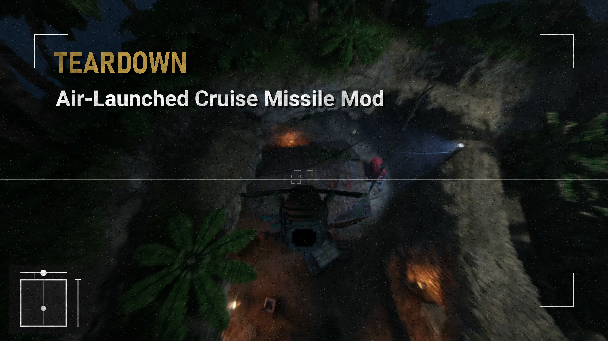

# Air-Launched Cruise Missile Mod

This is a mod for the Teardown game that adds a controllable missile with a physically accurate (to the extent required) flying model.

Supports multiplayer.

**Controls while flying**
- Pitch / Yaw - mouse
- Roll - A/D (or Shift + A/D for smooth controlling)
- Propulsion - Scroll Up/Down (+Shift for smaller step)
- Spread/Fold wings - Space
- Explode - LMB
- Free camera - MMB
- Detach - RMB

**Controls while holding a tablet**
- Launch / Reattach - LMB
- Set a marker - RMB
- Clear the marker - MMB

**Features**
- Foldable wings and working fins both affect the dynamics of the missile
- You can glide without the engine running
- Angle of attack is taken into account (20 degrees is optimal, then stall)
- Point velocity is taken into account (local velocity + angular velocity x radius vector)
- Detonation timer of 0.25 seconds

**Forces**
- Gravity
- Thrust
- Lift: each wing and fin separately (forward-normal projection), body (axis projection)
- Drag: missile body (3 signed sides), wings and fins (top and front for wings, side for fins)
- Small angular velocity damping for body (to reduce oscillations, but also because I cannot calculate every detail)
- Lift and drag create torque depending on the surface position
